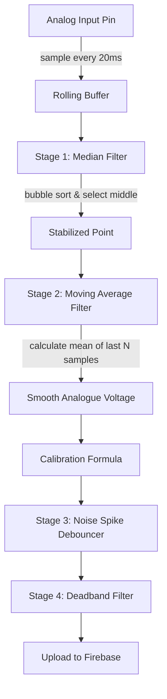

# System Methodology & Architecture

This document details the engineering methods, mathematical calibrations, data filtering algorithms, and software development cycles utilized in the **MSU Water Monitoring & Control System**.

---

## 1. Development Methodology

The project was developed using the **Agile Development Model (Scrum Framework)**. This methodology was selected to handle the hardware-software integration constraints iteratively:


1.  **Iterative Integration Sprints**: Hardware edge nodes (ESP32) and the web application (React) were developed in parallel, using Firebase as a mock buffer before real sensors were wired.
2.  **Continuous Refinement**: Real-world water turbulence, analog noise, and connection drops at the reservoir site led to subsequent sprints focused on digital signal filtering and dual Ethernet/Wi-Fi failover.
3.  **Cross-Platform Deployments**: Unified TypeScript styling allowed compile-time target switching between Web and Native Android wrappers.

---

## 2. Sensor Processing & Signal Filtering Algorithms

Raw analog signals from pH probes and hydrostatic pressure sensors are highly susceptible to noise (spikes, ripples, and electromagnetic interference from water pumps). The ESP32 implements a **dual-stage non-blocking digital filter pipeline** at a 20ms sampling rate.



### 2.1 Stage 1: Median Filter
*   **Purpose**: Eliminates extreme high/low transient spikes caused by bubbles or nearby electrical surges.
*   **Logic**: Every 20ms, raw analog readings are pushed into a rolling buffer of size $N$ (e.g. `FILTER_MEDIAN_WINDOW = 5`). The buffer is sorted using a non-blocking bubble sort, and the median value is extracted.
*   **C++ Bubble Sort Code Snippet**:
    ```cpp
    void sortArray(float arr[], int n) {
      for (int i = 0; i < n - 1; i++) {
        for (int j = 0; j < n - i - 1; j++) {
          if (arr[j] > arr[j + 1]) {
            float temp = arr[j];
            arr[j] = arr[j + 1];
            arr[j + 1] = temp;
          }
        }
      }
    }
    ```

### 2.2 Stage 2: Moving Average Filter
*   **Purpose**: Dampens high-frequency ripple on the signal to produce stable, smooth outputs.
*   **Logic**: The output of the Median Filter is pushed into a secondary circular average buffer (size $M = 10$). The mean of these values is calculated to represent the stable voltage reading.

### 2.3 Stage 3: Electrical & Physical Bounds Validation
To prevent corrupted data from writing to the database, values must pass two gates:
1.  **Electrical Bounds**: Standard analog inputs on the ESP32 range from $0.0\text{V}$ to $3.3\text{V}$. Safe operational limits are set to $0.05\text{V} < V_{raw} < 3.25\text{V}$. Values outside this range signify a physical wire break or short circuit, flagging a sensor fault and freezing the last known good value.
2.  **Physical Chemical/Volume Limits**:
    *   $0.0 \le \text{pH} \le 14.0$
    *   $-0.5\text{m} \le \text{Water Height} \le (\text{Tank Height} + 0.5\text{m})$

### 2.4 Stage 4: Deadband Filtering
To optimize bandwidth and database writes, the system applies a deadband limit:
*   **Water Level Deadband**: $1\%$ change.
*   **pH Level Deadband**: $0.05\text{ pH}$ change.
Telemetry is only transmitted to Firebase if the current stable reading exceeds the deadband offset from the last uploaded value, or if a status update is forced.

---

## 3. Mathematical Calibration Models

The system translates raw voltage readings ($V_{raw}$) to environmental units using remote calibration parameters.

### 3.1 Hydrostatic Level Calibration
The level sensor computes water column height by mapping the raw voltage linearly between the configured minimum empty voltage ($V_{min}$) and maximum full voltage ($V_{max}$):

$$\text{Height (meters)} = \left( \frac{V_{raw} - V_{min}}{V_{max} - V_{min}} \right) \times \text{Tank Height}$$

$$\text{Level (percentage)} = \text{Clamp} \left( \frac{\text{Height}}{\text{Tank Height}} \times 100 + \text{Level Offset}, \ 0, \ 100 \right)$$

### 3.2 pH Calibration
The pH probe calibration utilizes a reference neutral voltage ($V_{neutral}$, voltage at pH 7.00) and a slope coefficient ($\text{Slope}$, volts per pH unit):

$$\text{pH} = 7.0 + \left( \frac{V_{neutral} - V_{raw}}{\text{Slope}} \right) + \text{pH Offset}$$

---

## 4. Connectivity & Network Failover Methodology
 
The system is engineered for continuous operation, surviving severe power cuts and network blackouts common in physical installations:

1.  **Dual Link Failover**: The ESP32 monitors physical LAN connection on the Ethernet port. If the link goes down, it switches automatically to backup Wi-Fi.
2.  **Automatic Offline Interlocks**: Automatic pump safeguards (turning off the pump if the level goes below 20%) run locally on the ESP32. It does not need an active internet connection to execute these emergency triggers.

---

## 5. Database Schema & Data Models

### 5.1 Firebase Realtime Database (RTDB) Schema

```json
{
  "tanks": {
    "1": {
      "id": "1",
      "name": "Reservoir Tank 1",
      "waterLevel": 75,
      "waterHeight": 1.5,
      "phLevel": 7.2,
      "status": "safe",
      "assignedWorker": "user_id_123",
      "pumpOn": true,
      "enabled": true,
      "levelVmin": 0.25,
      "levelVmax": 3.0,
      "tankHeight": 5.0,
      "levelOffset": 0,
      "phNeutralVoltage": 2.5,
      "phSlope": 0.18,
      "phOffset": 0.0,
      "phSensorOk": true,
      "levelSensorOk": true,
      "lowLevelAlert": "NORMAL",
      "highLevelAlert": "NORMAL",
      "phAlert": "NORMAL",
      "lastUpdate": 17823482312,
      "rssi": -50,
      "wifiConnected": true,
      "firebaseConnected": true,
      "ethConnected": false,
      "location": "Main Reservoir Area"
    }
  },
  "config": {
    "lowLevelThreshold": 20,
    "overflowThreshold": 95,
    "minPh": 6.5,
    "maxPh": 8.5,
    "maintenanceMode": false,
    "pumpControlLock": false
  },
  "notifications": {
    "notif_1718023": {
      "id": "notif_1718023",
      "title": "Low Level Alert",
      "message": "Reservoir Tank 1 level dropped below 20%. Current level: 18%.",
      "type": "warning",
      "timestamp": 17823482342,
      "read": false
    }
  },
  "logs": {
    "log_1718045": {
      "id": "log_1718045",
      "action": "Pump Activating",
      "details": "Pump Activating! Triggered by critical water level: 18%.",
      "performedBy": "ESP32 System",
      "logLevel": "INFO",
      "timestamp": 17823482350
    }
  }
}
```

### 5.2 Firestore Users Collection Schema
*   **Collection**: `users`
*   **Document Schema**:
    ```json
    {
      "id": "user_auth_id",
      "username": "Operator Name",
      "email": "operator@msu.edu",
      "role": "worker", // admin | worker | viewer
      "jobTitle": "Lead Water Technician",
      "status": "active" // active | inactive
    }
    ```
