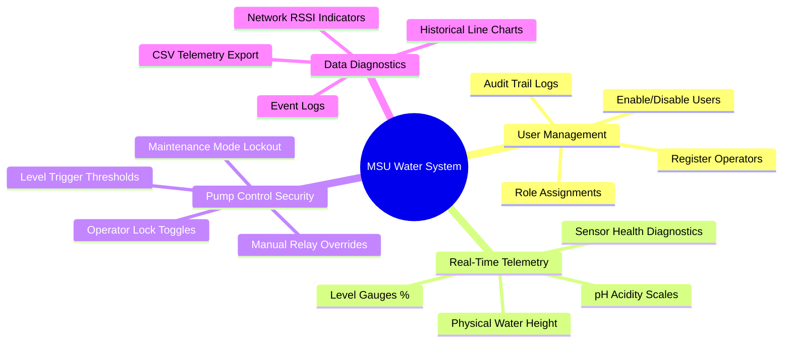

# Software Requirements Specification (SRS)

## 1. Introduction

### 1.1 Purpose
This document specifies the software requirements for the **Mindanao State University (MSU) Water Monitoring & Control System**. This system is designed to automate water level tracking and pH monitoring of university reservoirs, protect water pumps through automated safety interlocks, and offer administrative control over system thresholds, calibrations, and user authentication roles.

### 1.2 Scope
The system consists of:
1.  **ESP32 IoT Edge Nodes**: Hardware controllers deployed at water reservoirs to collect real-time sensor metrics and execute relay pump signals.
2.  **Firebase Realtime Database & Firestore**: Backend database layers hosting live telemetry feeds, system control locks, historical events, and account access permissions.
3.  **Cross-Platform UI Clients**: A unified codebase compiling to a React Single Page Application (Web) and an Android Mobile Application (via Capacitor) providing graphical dashboards, user administration tools, logs, and CSV reports.

---

## 2. Overall Description

### 2.1 Product Functions

*   **Real-Time Live Telemetry Monitoring**: Dynamic display of water tank levels (percentage and height in meters) and pH acidity.
*   **Sensor Health Diagnostics**: Verification of electrical connectivity for level and pH sensors (e.g. reporting open circuits or short circuits).
*   **Automated Pump Interlocks**: Automatically toggling physical relays to prevent reservoir dry-run (damage from running empty) or overflows.
*   **Administrative Access Controls**: User role definitions with specific read/write capabilities (Admins vs. Worker Operators).
*   **Remote Sensor Calibration**: Tuning sensor coefficients (Vmin, Vmax, pH slope, voltage reference, offset) in real-time without recompiling ESP32 firmware.

### 2.2 User Classes & Roles

| Role | Description | Access Rights |
| :--- | :--- | :--- |
| **Super-Admin** | System Owners / Creators | Access to all system commands, user registration, configuration limits, and manual overrides. Cannot be deleted by standard Admins. |
| **Administrator**| System Supervisors | Access to user management, configuration limits, calibrations, and pump control locks. |
| **Worker** | On-site Technicians / Operators | Access to view live telemetry, view system logs, and control assigned pumps (unless Pump Control Lock is active). |
| **Viewer** | General Public / Observers | Read-only access to the dashboard. Cannot view logs, edit configurations, or control pumps. |

### 2.3 Operating Environment
*   **Web Client**: Modern web browsers (Chrome, Edge, Safari, Firefox) on desktop and mobile viewports.
*   **Mobile Client**: Android 8.0 (API Level 26) or higher.
*   **Hardware Node**: ESP32 core architecture connected via LAN8720 Ethernet transceiver (primary) or 2.4GHz Wi-Fi (secondary).

---

## 3. Functional Requirements

### 3.1 Telemetry Dashboard (FR-01)
*   **FR-01.1**: The system must display the live water level as a percentage (0% to 100%) and a physical height (meters) for all active tanks.
*   **FR-01.2**: The system must display the live pH value on a color-coded gauge (Safe: Green, Unsafe: Red).
*   **FR-01.3**: The system must display communication metrics (Wifi/Ethernet status, last update timestamp, signal strength RSSI in dBm).
*   **FR-01.4**: The system must display sensor health statuses ("OK" or "Fault").

### 3.2 Pump and System Controls (FR-02)
*   **FR-02.1**: Standard Admins and Super-Admins must be able to lock out worker pump override controls (`pumpControlLock = true`).
*   **FR-02.2**: The system must support a `maintenanceMode` toggle. When active, it must:
    1.  Force the physical pump relay to shut off.
    2.  Prevent standard users from turning the pump back on.
    3.  Suppress all system notifications and alarms.
*   **FR-02.3**: Manual pump overrides must write to the system event log, logging the email of the operator who triggered the toggle.

### 3.3 Sensor Calibration (FR-03)
*   **FR-03.1**: The system must support independent sensor calibrations per tank node, adjusting the variables `levelVmin`, `levelVmax`, `tankHeight`, `levelOffset`, `phNeutralVoltage`, `phSlope`, and `phOffset` dynamically.
*   **FR-03.2**: Calibration adjustments made in the Admin Panel must immediately trigger updates in the Firebase database and propagate to the ESP32 node within 1 second.

### 3.4 Alerts and Logs (FR-04)
*   **FR-04.1**: The system must register alarm events for low water level, overflow level, and out-of-range pH readings.
*   **FR-04.2**: The ESP32 must log all hardware alerts, network reconnects, and sensor fault exceptions.
*   **FR-04.3**: The web interface must maintain an audit log of administrative actions (e.g. user creation, setting modifications, calibrations).

---

## 4. Non-Functional Requirements

### 4.1 Performance & Reliability
*   **Latency**: Live telemetry updates must reflect on the client interface within 500 milliseconds of being written by the ESP32.
*   **Database Syncing**: The Firebase connection must handle automated reconnections dynamically.
*   **Offline Operation**: The ESP32 must continue automatic local pump safety controls (dry-run prevention/overflow shutoff) based on its last cached parameters even when completely disconnected from the internet.

### 4.2 Security & Permissions
*   **Role-Based Access (RBAC)**: Firestore security rules must restrict write access to `users` and `config` collections exclusively to authenticated Administrators and Super-Admins.
*   **Realtime Database Rules**: Read/write paths must validate authentication tokens. Only active users defined in Firestore should gain database permissions.
*   **Password Safety**: The system must securely process passwords utilizing Firebase Authentication.
