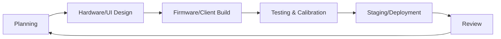
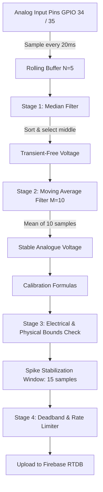

# System Methodology & Architecture

This document details the engineering methods, mathematical calibrations, data filtering algorithms, and software development cycles utilized in the **MSU Water Monitoring & Control System**.

---

## 1. Development Methodology

The project was developed using the **Agile Development Model (Scrum Framework)**. This methodology was selected to handle hardware-firmware-software constraints iteratively across modular layers:



1. **Modular Architecture Sprints**:
   - Edge firmware (`backend/firmware/esp32_firmware.ino`) runs FreeRTOS dual-core tasking: `sensorTask` on Core 1 (priority 2) for deterministic 20ms ADC sampling, and `networkTask` on Core 0 (priority 1) for HTTPS/TLS communications.
   - Cloud rules (`backend/cloud/database.rules.json`, `backend/cloud/firestore.rules`) secure real-time messaging and account roles.
   - Frontend web application (`frontend/`) and mobile wrapper (`mobile/`) consume centralized state from Firebase.
2. **Continuous Signal & Connectivity Refinement**: Real-world water turbulence, sensor drift, and reservoir network dropouts prompted sprints dedicated to 4-stage digital filtering, zombie-socket watchdog recovery, and an offline 20-entry RAM ring buffer.
3. **Cross-Platform Deployments**: A unified React 18 + TypeScript codebase compiles to a responsive Web SPA (Vite) and an Android native wrapper (Capacitor).

---

## 2. Sensor Processing & Signal Filtering Algorithms

Raw analog signals from the pH electrode and hydrostatic level sensor are susceptible to electromagnetic pump noise, water turbulence, and voltage ripple. The ESP32 executes a **4-stage non-blocking digital filter and validation pipeline**:



### 2.1 Execution Scheduling
- **Raw Sampling Interval (`SENSOR_SAMPLE_INTERVAL`)**: `20 ms` (50 Hz). `sampleSensorsNonBlocking()` executes on Core 1, pushing raw 12-bit ADC conversions (`(analogRead(pin) / 4095.0) * 3.3`) into circular buffers.
- **Processing Interval (`SENSOR_PROCESSING_INTERVAL`)**: `200 ms` (5 Hz). Runs full filtering, calibration, spike evaluation, and alert checks.
- **Telemetry Upload Rate Limit**:
  - Minimum write interval (`MIN_WRITE_INTERVAL`): `1,000 ms` (1 second).
  - Telemetry heartbeat interval (`SENSOR_WRITE_HEARTBEAT`): `10,000 ms` (10 seconds forced write if stable).
  - History sampling interval (`HISTORY_SAMPLE_INTERVAL`): `600,000 ms` (10 minutes).

### 2.2 Stage 1: Median Filter
* **Purpose**: Eliminates high-amplitude transient spikes caused by bubbles, electrical switching, or pump start surges.
* **Logic**: Raw readings are stored in a 5-element circular array (`FILTER_MEDIAN_WINDOW = 5`). A non-blocking bubble sort arranges samples to extract the true median (index 2):
  ```cpp
  void sortArray(float arr[], int n) {
    for (int i = 0; i < n - 1; i++) {
      for (int j = 0; j < n - i - 1; j++) {
        if (arr[j] > arr[j + 1]) {
          float temp = arr[j];
          arr[j] = arr[j + 1];
          arr[j + 1] = temp;
        }
      }
    }
  }
  ```

### 2.3 Stage 2: Moving Average Filter
* **Purpose**: Suppresses high-frequency analog ripple to produce a steady DC voltage.
* **Logic**: The median filter output is appended to a circular average buffer (`FILTER_AVERAGE_WINDOW = 10`). The arithmetic mean of the last 10 samples represents the filtered voltage ($V_{stable}$).

### 2.4 Stage 3: Bounds Validation & Spike Rejection
1. **Electrical Voltage Bounds**:
   - Safe operational limits: $0.05\text{V} < V_{raw} < 3.25\text{V}$.
   - Voltages $\le 0.05\text{V}$ (open circuit / disconnected wire) or $\ge 3.25\text{V}$ (short circuit to rail) trigger a fault timer.
   - If an electrical fault persists for $\ge 10,000\text{ ms}$ (`SENSOR_FAULT_TIMEOUT`), the sensor health is set to `false`, an emergency error is logged, and the pump is prevented from auto-starting.
   - Recovery requires stable readings for at least $3,000\text{ ms}$.
2. **Physical Environmental Bounds**:
   - pH: $0.0 \le \text{pH} \le 14.0$
   - Water Height: $-0.5\text{m} \le \text{Height} \le (\text{Tank Height} + 0.5\text{m})$
3. **Spike Stabilization Window**:
   - If a step change exceeds the spike threshold ($\Delta\text{pH} \ge 1.50$ or $\Delta\text{Level} \ge 15\%$), it is ignored until confirmed across **15 consecutive samples** (`STABILIZATION_SAMPLES = 15`), preventing physical sloshing or turbulence from generating false triggers.

### 2.5 Stage 4: Deadband Filtering
To minimize unnecessary database writes and save cellular/Wi-Fi bandwidth, data writes to Firebase are gated by a deadband check:
* **Water Level Deadband (`WATER_LEVEL_DEADBAND`)**: **2%** change.
* **pH Level Deadband (`PH_LEVEL_DEADBAND`)**: **0.15 pH** change.
* Telemetry is only pushed to `/tanks/1` if the reading exceeds these offsets from the last sent value, or when the 10-second heartbeat timer elapses.

---

## 3. Mathematical Calibration Models

The system converts calibrated voltage readings into metric and percentage values. Calibration parameters are synchronized dynamically from Firebase RTDB without reflashing the firmware.

### 3.1 Hydrostatic Level Calibration
The submersible pressure sensor outputs an analog voltage proportional to hydrostatic water depth ($P = \rho g h$):

$$\text{Height (meters)} = (V_{raw} - V_{min}) \times \left( \frac{\text{Tank Height}}{V_{max} - V_{min}} \right)$$

$$\text{Clamped Height} = \text{Clamp}(\text{Height}, \ 0.0, \ \text{Tank Height})$$

$$\text{Level (percentage)} = \text{Clamp}\left( \left( \frac{\text{Clamped Height}}{\text{Tank Height}} \times 100 \right) + \text{Level Offset}, \ 0, \ 100 \right)$$

* **Default Parameters**:
  - $V_{min}$ (`levelVmin`): `0.25 V` (empty tank sensor floor)
  - $V_{max}$ (`levelVmax`): `3.00 V` (full tank sensor ceiling)
  - Tank Height (`tankHeight`): `5.00 m`
  - Level Offset (`levelOffset`): `0.00 %`

### 3.2 pH Calibration
The glass electrode potential varies linearly with hydrogen ion concentration according to the Nernst equation:

$$\text{pH} = 7.0 + \left( \frac{V_{neutral} - V_{raw}}{\text{Slope}} \right) + \text{pH Offset}$$

* **Default Parameters**:
  - Neutral Voltage (`phNeutralVoltage`): `2.50 V` (reading at pH 7.00 buffer)
  - Slope Sensitivity (`phSlope`): `0.18 V/pH`
  - pH Offset (`phOffset`): `0.00`

---

## 4. Control Rules, Safeguards & Network Failover

### 4.1 Automatic Pump Control Logic
Pump control is executed deterministically on Core 1 by `processAutomaticPumpControl()`:
1. **Low-Level Refill Trigger**:
   - When water level falls to $\le \text{lowLevelThreshold}$ (default **15%**), the pump is **started** automatically.
   - **Anti-Chatter Cooldown**: Must satisfy `now - lastPumpStopTime >= 30,000 ms` (`PUMP_MIN_OFF_TIME = 30s`) before starting, preventing relay rapid-cycling.
2. **Overflow Shutoff Protection**:
   - When water level reaches $\ge \text{overflowThreshold}$ (default **95%**), the pump is **stopped** immediately.
3. **Safety Interlocks**:
   - If `maintenanceMode == true`, the pump is forced **OFF** and automatic/manual starts are locked out.
   - If `levelSensorOk == false`, the pump is forced **OFF** to avoid dry-running or unmonitored filling.
   - If `pumpControlLock == true`, manual toggles by Worker operators are rejected; only Admins can override.

### 4.2 Network Failover & Resilience
1. **Dual-Interface Failover**:
   - Primary: LAN8720 Ethernet (MDC: GPIO 23, MDIO: GPIO 18).
   - Backup: Wi-Fi 2.4GHz with exponential retry backoff (15s $\rightarrow$ 30s $\rightarrow$ 60s max).
2. **Network Zombie-Socket Watchdog**:
   - If HTTPS requests fail continuously for $\ge 90\text{ seconds}$ despite `WL_CONNECTED`, `checkNetworkWatchdog()` tears down the TCP socket and triggers a full Wi-Fi reconnection.
3. **Offline RAM Ring Buffer**:
   - Core 1 buffers up to 20 critical/error log entries in a RAM ring buffer (`ramLogBuffer[20]`).
   - When network connectivity is restored, `flushRamLogBuffer()` pushes all buffered events to Firebase `/logs`.

---

## 5. Database Schema & Data Models

### 5.1 Firebase Realtime Database (RTDB) Schema

```json
{
  "tanks": {
    "1": {
      "id": "1",
      "name": "Reservoir Tank 1",
      "waterLevel": 75,
      "waterHeight": 3.75,
      "phLevel": 7.20,
      "status": "safe",
      "pumpOn": false,
      "enabled": true,
      "levelVmin": 0.25,
      "levelVmax": 3.00,
      "tankHeight": 5.00,
      "levelOffset": 0.00,
      "phNeutralVoltage": 2.50,
      "phSlope": 0.18,
      "phOffset": 0.00,
      "phSensorOk": true,
      "levelSensorOk": true,
      "lowLevelAlert": "NORMAL",
      "highLevelAlert": "NORMAL",
      "phAlert": "NORMAL",
      "lastUpdate": 1782348231200,
      "rssi": -55,
      "wifiConnected": true,
      "ethConnected": false,
      "firebaseConnected": true,
      "location": "Main Reservoir Area",
      "assignedWorker": "user_uid_123"
    },
    "2": {
      "id": "2",
      "name": "Reservoir Tank 2",
      "waterLevel": 0,
      "waterHeight": 0,
      "phLevel": 7.0,
      "status": "offline",
      "pumpOn": false,
      "enabled": false,
      "location": "North Campus Extension"
    }
  },
  "config": {
    "lowLevelThreshold": 15,
    "overflowThreshold": 95,
    "minPh": 6.5,
    "maxPh": 8.5,
    "maintenanceMode": false,
    "pumpControlLock": false
  },
  "notifications": {
    "notif_1718023": {
      "id": "notif_1718023",
      "title": "Low Level Alert",
      "message": "Reservoir Tank 1 level dropped below 15%. Current level: 14%.",
      "type": "warning",
      "timestamp": 1782348234200,
      "read": false
    }
  },
  "logs": {
    "log_1718045": {
      "id": "log_1718045",
      "action": "Pump Controller",
      "details": "Pump started automatically. Water level: 14% fell to low level threshold (15%).",
      "performedBy": "ESP32 System",
      "logLevel": "INFO",
      "timestamp": 1782348235000
    }
  },
  "history": {
    "tanks": {
      "1": {
        "-O_sample_123": {
          "waterLevel": 75,
          "waterHeight": 3.75,
          "phLevel": 7.20,
          "pumpOn": false,
          "timestamp": 1782348231200
        }
      }
    }
  }
}
```

### 5.2 Cloud Firestore Users Collection Schema
* **Collection**: `users`
* **Document ID**: Firebase Auth `uid`
```json
{
  "id": "auth_uid_123",
  "username": "Operator Name",
  "email": "operator@msu.edu",
  "role": "worker",
  "jobTitle": "Lead Water Technician",
  "status": "active",
  "createdAt": 1708000000000
}
```

* **Role Definitions**:
  - `admin`: Full configuration, user provisioning, tank calibration, and lock overrides.
  - `worker`: Live monitoring, viewing logs/reports, manual pump toggling (unless locked).
  - `viewer`: Read-only telemetry viewing.

### 5.3 Hardware Controller Architecture
* **Controller**: **ESP32 Dev Module** (Dual-Core Xtensa LX6 @ 240MHz).
* **Orange Pi One**: *Not implemented / TO CONFIRM*. The physical prototype relies strictly on the ESP32 for standalone sensor acquisition, FreeRTOS control, and direct cloud streaming without requiring an external single-board computer gateway.
