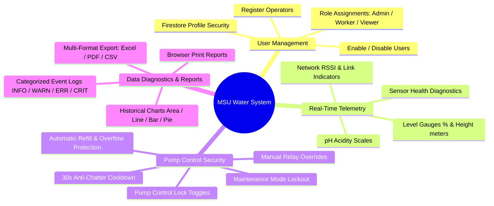

# Software Requirements Specification (SRS)

## 1. Introduction

### 1.1 Purpose
This document specifies the software requirements for the **Mindanao State University (MSU) Water Monitoring & Control System**. The system automates real-time water level and pH monitoring across university reservoirs, protects water pumps via deterministic safety interlocks, provides remote sensor calibration, and offers role-based administrative control.

### 1.2 Scope
The system consists of:
1. **ESP32 IoT Edge Nodes (`backend/firmware/`)**: Microcontroller edge units deployed at water reservoirs executing FreeRTOS dual-core tasks to sample analog sensors, execute automatic pump control, and stream telemetry over dual Ethernet/Wi-Fi links.
2. **Firebase Cloud Layer (`backend/cloud/`)**:
   - **Realtime Database (RTDB)**: Real-time telemetry bus (`/tanks`), system configurations (`/config`), alarm notifications (`/notifications`), event logs (`/logs`), and 10-minute historical samples (`/history`).
   - **Cloud Firestore**: Role-based operator profiles and account permissions (`/users`).
3. **Cross-Platform Client Layer**:
   - **Web SPA (`frontend/`)**: React 18 + TypeScript application built with Vite and styled with Tailwind CSS / Radix UI.
   - **Android Mobile App (`mobile/`)**: Capacitor-wrapped native APK sharing the same reactive frontend bundle.
   - **Multi-Format Reporting**: Telemetry exports in **Excel (.xlsx)**, **PDF (.pdf)**, and **CSV (.csv)** formats, plus browser printing.

---

## 2. Overall Description

### 2.1 Product Functions

* **Real-Time Live Telemetry Monitoring**: Dynamic visualization of water tank volume (percentage 0–100% and depth in meters) and pH acidity.
* **Sensor Health Diagnostics**: Continuous verification of analog wiring (detecting open-circuit $V \le 0.05\text{V}$ and short-circuit $V \ge 3.25\text{V}$).
* **Automated Pump Interlocks**: Deterministic relay control on Core 1 to refill when $\le 15\%$ and shut off when $\ge 95\%$, with 30-second anti-chatter protection.
* **Administrative Access Controls**: Role-Based Access Control (RBAC) separating Administrators, Workers, and Viewers.
* **Remote Sensor Calibration**: Dynamic tuning of sensor calibration coefficients ($V_{min}$, $V_{max}$, tank height, level offset, $V_{neutral}$, pH slope, pH offset) from the web dashboard without recompiling firmware.
* **Historical Reporting**: Automated 10-minute historical telemetry sampling with interactive Recharts visualizations and export to Excel (.xlsx), PDF (.pdf), and CSV (.csv).

### 2.2 User Classes & Roles

| Role | Description | Implemented Capabilities |
| :--- | :--- | :--- |
| **Administrator** | System Supervisors | Full access: user provisioning, threshold configuration, tank calibration, maintenance mode, and pump control locks. |
| **Worker** | On-site Technicians / Operators | Access to live telemetry, viewing event logs, generating reports, and manual pump control (unless Pump Control Lock is active). |
| **Viewer** | Observers / General Public | Read-only access to the live dashboard. Cannot control pumps, view logs, export reports, or modify configuration. |
| **Super-Admin** *(Planned)* | Multi-tier owner role | Planned feature: Hierarchical privilege preventing standard Admins from modifying owner credentials (requires backend Cloud Functions). |

### 2.3 Operating Environment
* **Web Client**: Modern web browsers (Google Chrome, Microsoft Edge, Mozilla Firefox, Safari) on desktop and mobile viewports.
* **Mobile Client**: Android 8.0 (API Level 26) or higher via Capacitor wrapper.
* **Hardware Edge Node**: ESP32 Dev Module (Dual-core Xtensa LX6 @ 240MHz) connected via LAN8720 Ethernet PHY (primary) or 2.4GHz Wi-Fi (backup).
* **Controller Note**: The operational edge controller is strictly the ESP32 Dev Module. *(Orange Pi One: Not implemented / TO CONFIRM as an unadopted alternative).*

---

## 3. Functional Requirements

### 3.1 Telemetry Dashboard (FR-01)
* **FR-01.1**: The system must display live water levels as a percentage (0% to 100%) and physical height (meters) for all active tanks.
* **FR-01.2**: The system must display live pH values on a color-coded gauge (Safe: Green [6.5–8.5], Warning/Critical: Amber/Red).
* **FR-01.3**: The system must display network metrics (Ethernet/Wi-Fi active link, last update timestamp, and RSSI in dBm).
* **FR-01.4**: The system must report individual sensor health status ("OK" vs "Fault").
* **FR-01.5**: For expansion tanks without hardware nodes (Tanks 2–4), the UI must display a **"Planned - IoT node not yet installed"** indicator with placeholder values (`--`).

### 3.2 Pump & System Controls (FR-02)
* **FR-02.1**: Administrators must be able to lock out manual pump toggling for Worker operators (`pumpControlLock = true`).
* **FR-02.2**: The system must support a `maintenanceMode` toggle that:
  1. Forces the physical pump relay OFF immediately.
  2. Blocks all automatic and manual pump activations.
  3. Suppresses audible alarms and warning banners.
* **FR-02.3**: Automatic pump control must start the pump when water level $\le$ `lowLevelThreshold` (default 15%) and stop the pump when level $\ge$ `overflowThreshold` (default 95%).
* **FR-02.4**: An anti-chatter cooldown of 30 seconds (`PUMP_MIN_OFF_TIME = 30000ms`) must elapse between consecutive pump activations.
* **FR-02.5**: Manual pump overrides must log the operator's identity and timestamp to the Firebase event log.

### 3.3 Remote Sensor Calibration (FR-03)
* **FR-03.1**: The system must support remote calibration adjustments for the active tank node (`tanks/1`), updating $V_{min}$, $V_{max}$, tank height, level offset, $V_{neutral}$, pH slope, and pH offset. *(Multi-tank independent calibration: Planned for expansion nodes).*
* **FR-03.2**: Calibration adjustments committed in the Admin Panel must persist to Firebase RTDB and synchronize with the ESP32 node during its next polling cycle ($\le 1\text{ second}$).

### 3.4 Alerts, Logs & Reports (FR-04)
* **FR-04.1**: The system must track alert states (`NORMAL`, `WARNING`, `CRITICAL`, `RECOVERED`) with a 5-second validation window to prevent false alarms.
* **FR-04.2**: The ESP32 must log hardware boot events, network disconnect/reconnect events, sensor fault exceptions, and automatic pump actions.
* **FR-04.3**: The web interface must maintain an audit log of administrative actions with filterable severity levels (`INFO`, `WARNING`, `ERROR`, `CRITICAL`).
* **FR-04.4**: The system must provide multi-format report exports:
  1. **Excel (.xlsx)** via `exceljs`
  2. **PDF (.pdf)** formatted tables via `jspdf` & `jspdf-autotable`
  3. **CSV (.csv)** raw comma-separated records
  4. Direct browser printing capability

---

## 4. Non-Functional Requirements

### 4.1 Performance & Reliability
* **Telemetry Latency**: Live telemetry updates from the ESP32 must reflect in the web/mobile UI within 500 milliseconds via Firebase WebSocket listeners.
* **Offline Operation**: The ESP32 must execute local automatic pump refill and overflow shutoff routines on Core 1 even when disconnected from the network.
* **Offline Log Buffering**: In the event of a network outage, the ESP32 must store up to 20 critical/error log events in an internal RAM ring buffer and automatically flush them to `/logs` upon reconnection.
* **Watchdog Protection**: A hardware task watchdog (`esp_task_wdt`) with a 30-second timeout must restart the ESP32 if either FreeRTOS task hangs. A 90-second network watchdog must reset the Wi-Fi stack if HTTPS requests consistently fail.

### 4.2 Security & Permissions
* **Firestore Security Rules**: Write access to `/users/{userId}` is strictly restricted to authenticated Administrators (`role == 'admin'`). Standard users may only update their own `username` and `jobTitle`.
* **Realtime Database Rules**: Read and write operations to `/tanks`, `/logs`, `/notifications`, `/config`, and `/history` require valid Firebase authentication (`auth != null`).
* **Credentials Storage**: Firmware secrets (`secrets.h`) must be separated from source control using template examples (`secrets.example.h`).
